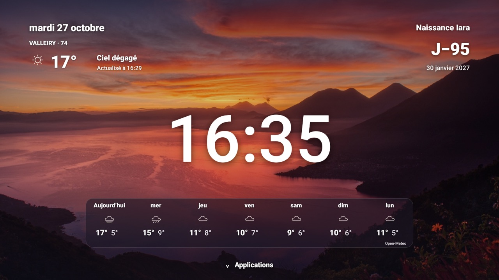

# SexyFreeboxPop · Salon

Accueil Android TV minimaliste pour Freebox Player Pop : paysage plein écran, grande horloge, météo locale et applications à la télécommande.



Premier prototype natif Android, installé sur le Player Pop Android 10 (API 29, ARM 32 bits), écran 1920 × 1080.

## Utilisation

- Le bouton Maison ouvre le paysage et la grande horloge centrale (heure de Paris).
- « Naissance Iara » affiche le décompte en jours calendaires jusqu’au **30 janvier 2027** : J−95 le 27 octobre 2026, « Jour J » à la date prévue, puis J+… après cette date. Il se met à jour au changement de jour et au retour sur l’accueil.
- La grande horloge et les textes utilisent des caractères renforcés, un blanc contrasté et des ombres discrètes pour rester lisibles sur le paysage.
- La date et les conditions actuelles à Valleiry (Haute-Savoie) apparaissent en haut à gauche. Une rangée affiche les sept prochains jours, avec conditions et températures minimales et maximales.
- Bas ou OK affiche le bandeau d’applications. Haut ou Retour le masque. Gauche, Droite et OK permettent de choisir une application.
- TV, Netflix et YouTube ouvrent les applications existantes, avec leurs comptes existants.
- Toutes les apps affiche les applications TV en pages de dix, dont le Play Store.
- Réglages donne accès aux paramètres Android, au Play Store, à AirPlay et au réseau.
- Retour revient à l’accueil depuis les pages de Salon. Dans les applications tierces, Maison revient à Salon.
- Mirroir explique la connexion et ouvre le récepteur AirPlay libre ; le nom réseau configuré est **TV du salon**.

## Modifications du Player

- Installation de `dev.salontv` (Salon).
- Installation du récepteur tiers libre et non modifié `io.github.jqssun.airplay`, version 0.0.36.
- Nom du récepteur configuré sur « TV du salon ».
- Réception audio ALAC activée ; affichage au-dessus des autres applications autorisé pour permettre au récepteur d’apparaître à la connexion (à valider avec une vraie session).
- Le paquet d’accueil `net.oqee.launcher` est désactivé pour l’utilisateur 0 afin que le bouton Maison ouvre Salon. L’application de télévision distincte `net.oqee.androidtv` reste active.
- Aucun remplacement de firmware, root, effacement de compte ou désinstallation d’une application existante.

## Retour à l’accueil Free

Avec le Mac et le Player sur le même réseau, double-cliquer sur `restore-free.command`.
Ce script réactive l’accueil d’origine et restaure son rôle d’accueil. Salon reste installé.
`activate-salon.command` réactive l’accueil personnalisé.
Pour un autre appareil, passer son adresse en argument (`./restore-free.command IP:5555`) ou définir `SALON_DEVICE=IP:5555`. Sur le Mac de développement, les scripts peuvent aussi lire `tools/device.txt`, un fichier local exclu de Git.

## Construction

L’accueil utilise uniquement les vues Android du système, sans moteur web, bibliothèque d’interface ni boucle d’animation permanente. L’horloge et le décompte utilisent les événements système de changement d’heure et de date. La photo est redimensionnée et chargée une seule fois par activité.

## Météo

La météo provient de [Open-Meteo](https://open-meteo.com/en/docs), pour les coordonnées de Valleiry (46.11106, 5.97037), avec le fuseau `Europe/Paris`. La température actuelle est une donnée météo modélisée, pas une mesure issue d’un capteur du Player.

Une requête HTTPS en arrière-plan actualise les données toutes les 30 minutes lorsque l’accueil est actif, ou à son retour si le cache a expiré. Une actualisation est aussi demandée au changement de jour. Les réponses sont conservées localement, avec leur date de récupération. En cas de panne, l’accueil conserve les dernières données et affiche leur ancienneté ; sans cache, il indique que la météo est indisponible. Aucun appel réseau ne bloque l’affichage ou la navigation.

Prérequis : Python 3, JDK 17, [Android SDK Command-Line Tools](https://developer.android.com/tools), Android Platform 29 et Build Tools 34.0.0.

Avec le SDK installé :

```sh
sdkmanager 'platforms;android-29' 'build-tools;34.0.0' 'platform-tools'
export JAVA_HOME=/chemin/vers/jdk-17
export ANDROID_HOME=/chemin/vers/android-sdk
python3 build.py
```

Le script accepte aussi l’arborescence locale de développement sous `tools/`. Le résultat signé pour développement est `output/salon-tv.apk`. Conserver le keystore local pour les futures mises à jour ; il n’est pas publié. La clé générée est une clé de développement, pas une clé de publication Play Store.

Installation sur un Player dont le débogage ADB est déjà accessible et autorisé :

```sh
adb connect IP_DU_PLAYER:5555
adb -s IP_DU_PLAYER:5555 install -r output/salon-tv.apk
./activate-salon.command IP_DU_PLAYER:5555
```

L’activation désactive **le paquet d’accueil** `net.oqee.launcher`, afin de libérer le bouton Maison. Elle conserve l’application TV distincte `net.oqee.androidtv`. Utiliser `restore-free.command` pour revenir à l’accueil d’origine.

`SALON_DEVICE=IP:5555 python3 verify.py` vérifie sur le Player les accès aux applications et la navigation à la télécommande. Cette commande ouvre les applications et change l’écran actif. La validation du rendu s’appuie aussi sur des captures du véritable écran.

## AirPlay et licences

Le récepteur est une application séparée issue de [jqssun/android-airplay-server](https://github.com/jqssun/android-airplay-server/releases/tag/v0.0.36), sous GPL-3.0. Son code source correspondant est disponible dans le dépôt amont. Salon ne contient pas son code ni ses bibliothèques. Installer séparément la version Android appropriée depuis les publications du projet amont ; aucun APK tiers n’est distribué ici.
Sa présence sur le réseau et son service Android sont vérifiés. Une session réelle de recopie, le son, le retour automatique après session et le redémarrage du boîtier restent à tester avec l’utilisateur. Les contenus protégés ne sont pas garantis.

## Performances

Les mesures exploratoires Android de lancement sont dans `output/benchmark.json`. Elles ne permettent **pas** de conclure que Salon est plus rapide : l’accueil système peut se relancer automatiquement pendant la mesure et certains temps sont nuls. Ce sont des temps d’activité, pas des temps d’apparition complète des contenus.
Les accès directs et l’absence de recommandations réseau réduisent le travail de l’accueil ; l’ouverture et la lecture dans les applications tierces dépendent de celles-ci.

## Fichiers de référence

`output/packages-before.txt` : inventaire avant modification.
`output/smoke-checks.json` : résultats des vérifications.
`output/home-first.png` et `output/apps.png` : captures sur le Player.
Les outils téléchargés, relevés d’appareil et clés de signature restent locaux et sont exclus du dépôt.
